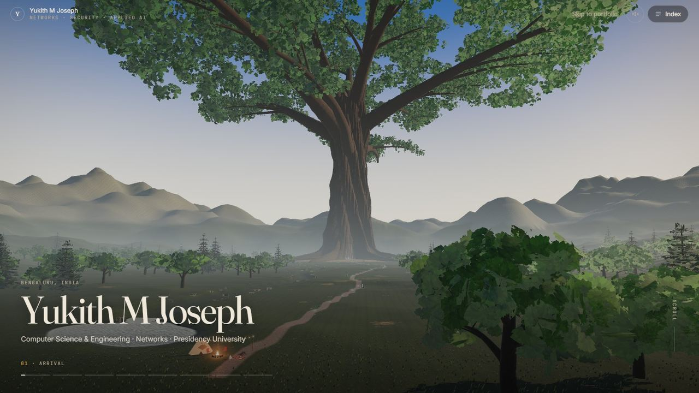
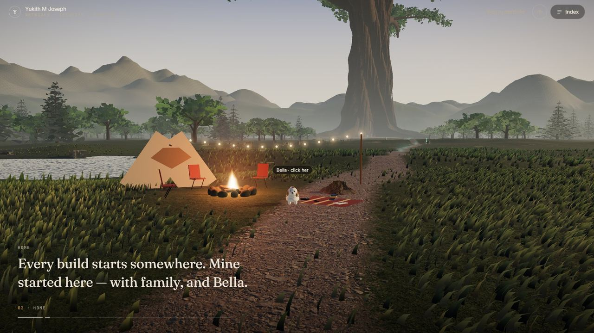
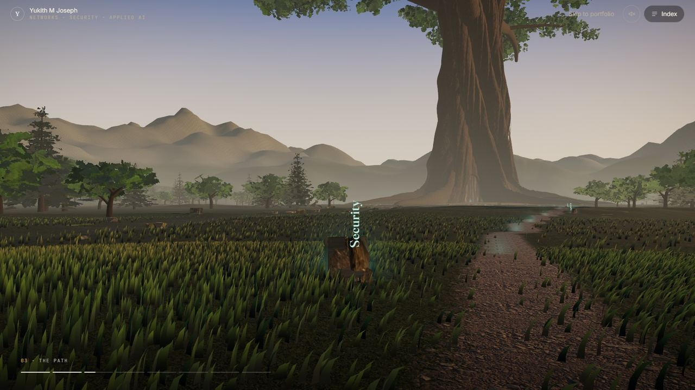
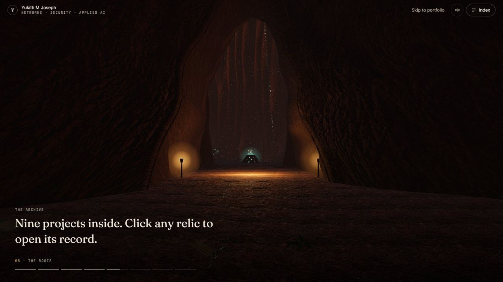
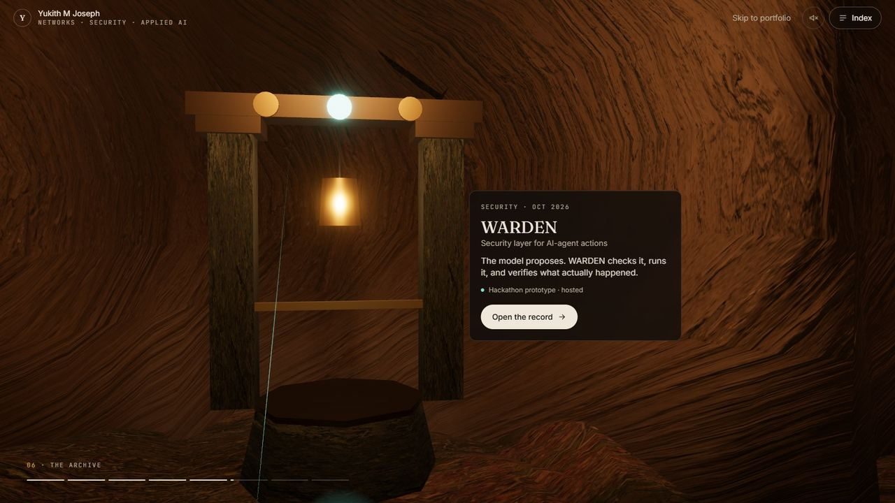
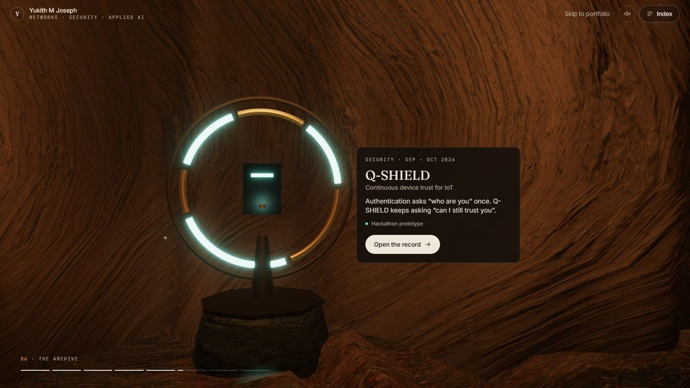
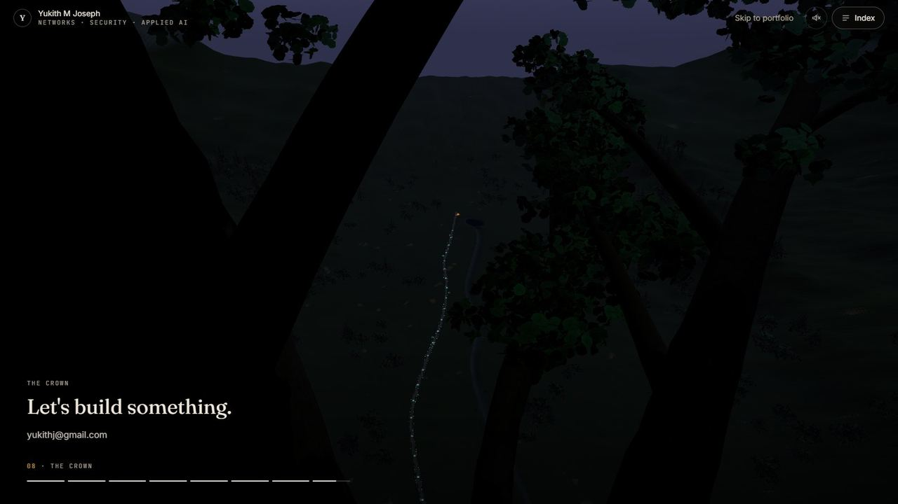

# Yukith M Joseph — The World Tree

A portfolio you can travel through. An ancient World Tree stands at the end of a valley; its roots
carry a network of light — the "wood wide web", for a student of computer networks — and inside its
hollow nine relics stand for nine projects. Every word the site says about a project, a role or a
result comes from the project's own repository or the current resume.

**Live:** <https://www.yukithjoseph.me>



| | |
|---|---|
|  |  |
|  |  |
|  |  |

## The journey

Scrolling is the only control you need. The camera follows an authored path through eight chapters
while the day turns from afternoon gold to blue hour:

1. **Arrival** — the valley and the World Tree on the horizon.
2. **Home** — a camp by the lake, family, Bella (click her), the things done off the clock.
3. **The path** — four waystones: Networks, Security, Applied AI, Systems.
4. **The World Tree** — the reveal.
5. **The roots** — the network converges on the entrance.
6. **The archive** — a round hall; the camera orbits from relic to relic. Click a relic (or the label
   beside it) to open its record.
7. **The rings** — 2024, 2025, 2026: milestones, results and roles.
8. **The crown** — out into the night above the valley, then the written portfolio.

Press <kbd>/</kbd> anywhere for the **index** (every project, chapter and section), or use **Skip to
portfolio**. The written portfolio below the journey is server-rendered, works without JavaScript
or WebGL, and contains everything the world shows.

## Stack

Next.js 16 (App Router) · React 19 · React Three Fiber 9 · three.js r185 (WebGL2) ·
@react-three/postprocessing · Lenis · Tailwind CSS v4. Ten runtime dependencies.

Rendering: ACES tone mapping, MSAA composer with restrained bloom and dithering, one sun with a
camera-following texel-snapped shadow frustum (it becomes moonlight after sunset), sky IBL rebuilt as
the light changes, exponential height fog patched into every material. Quality tiers (DPR, shadows,
post, foliage density, mesh resolution) are chosen per device and lowered at runtime if the frame
rate drops. Ambient sound is synthesised with Web Audio and is off until you turn it on.

## Develop

```bash
npm install
npm run dev            # http://localhost:3000
npm run build && npm start
```

Debugging and QA (with a dev or production server running):

```bash
# ?perf exposes window.__world; ?off=grass,forest,... disables systems; ?quality=low|medium|high
node scripts/shoot-cams.mjs   --url http://localhost:3000 --out shots --shots "arrival@0;hall@0.49"
node scripts/profile-world.mjs --url http://localhost:3000 --query perf --out prof --uncapped
node scripts/scene-stats.mjs   --url http://localhost:3000 --progress 0.2
node scripts/shoot-page.mjs    --url http://localhost:3000 --out page --targets record,work,contact
node --no-warnings --import ./scripts/ts-hooks.mjs scripts/check-tree.ts      # generator sanity
node --no-warnings --import ./scripts/ts-hooks.mjs scripts/check-terrain.ts   # geography sanity
node scripts/assets/build-assets.mjs   # rebuild textures/models from CC0 sources
```

The scripts drive Microsoft Edge by default (`CHROME_PATH` overrides it).

## Where things are

| Path | What |
|---|---|
| `src/data/` | All content — projects, experience, achievements, leadership, skills, profile, about. |
| `components/portfolio/`, `components/record/`, `components/index/` | The written portfolio, the record dialog, the index. |
| `components/experience/` | The World Tree journey: canvas, scene, journey UI, sound. |
| `lib/world/` | Geography, the tree generator, camera path, materials, atmosphere, network, store. |
| `public/assets/` | CC0 textures and models (see `docs/ASSETS.md`). |
| `docs/` | Research, art direction, content verification, audit, assets, progress. |

## Documentation

- [`docs/research/REFERENCES.md`](docs/research/REFERENCES.md) — the 17 reference sites, inspected live, and the comparison matrix.
- [`docs/ART_DIRECTION.md`](docs/ART_DIRECTION.md) — "The Root Network".
- [`docs/CONTENT_VERIFICATION.md`](docs/CONTENT_VERIFICATION.md) — the source of every fact, and what still needs review.
- [`docs/AUDIT.md`](docs/AUDIT.md) — the repository before this rebuild.
- [`docs/ASSETS.md`](docs/ASSETS.md) — asset inventory and licences.
- [`docs/PROGRESS.md`](docs/PROGRESS.md) — status, measurements and next steps.

## Credits

Textures and models: [Poly Haven](https://polyhaven.com) (CC0). Fonts: Fraunces, Inter and JetBrains
Mono (SIL OFL). Ideas learned from the portfolios listed in `docs/research/REFERENCES.md`; no code
or assets were taken from them.
